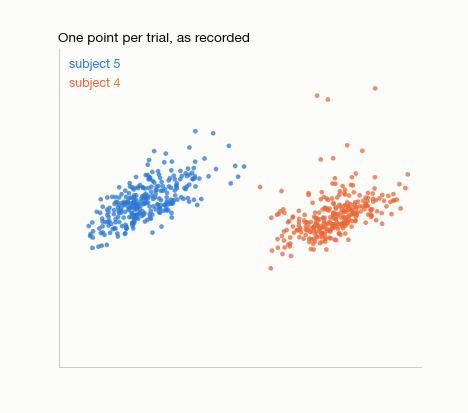
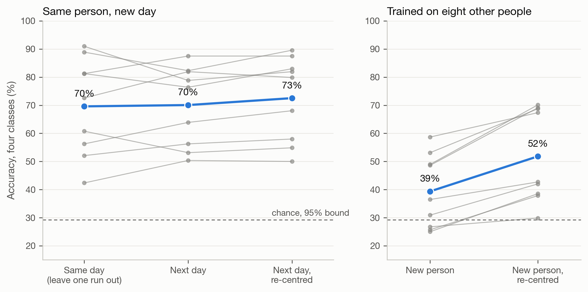
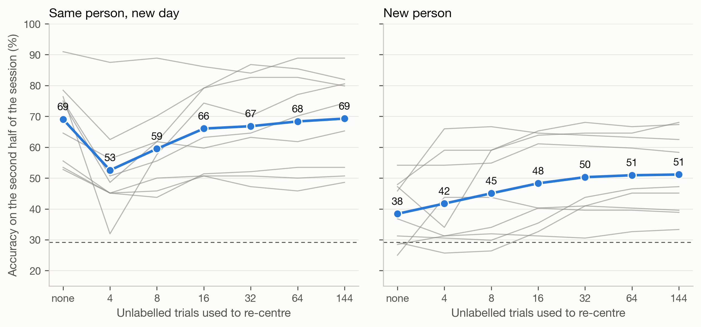

# mi-bci-transfer

Motor-imagery EEG decoding on BCI Competition IV dataset 2a (9 people, 2 days each, 4 classes, 22 channels), looking at what happens when the decoder meets a new day or a new person, and whether re-centering the covariance matrices helps.



Each point is one trial's covariance matrix, projected to two dimensions. Two people occupy different regions; after each person's matrices are whitened by their own mean, the clouds overlap. No labels are used for this step.

## Results

Four-class accuracy, mean over 9 subjects. Chance is 25%; with 288 test trials anything under 29% is indistinguishable from it.

| | Tangent space + LR | CSP + LDA |
|---|---|---|
| Same day, leave one run out | 69.6 | 64.0 |
| Train day 1, test day 2 | 70.1 | 63.0 |
| Same, re-centred | 72.5 | 68.4 |
| Train on 8 others, test on a new person | 39.4 | 41.9 |
| Same, re-centred | 51.8 | 53.7 |



Across people, re-centering improved all 9 subjects with both decoders (Wilcoxon p = 0.004, the smallest value possible with n = 9). With the tangent-space decoder three of the nine start below the chance bound; none are below it afterwards, though the lowest sits at 30%.

Across days the picture depends on the decoder. For CSP + LDA re-centering helped every subject (p = 0.004). For the tangent-space decoder the gain is 2.4 points and not significant (p = 0.08); that decoder loses nothing between days on this dataset to begin with.

### How many trials does it take

The reference matrix was estimated from the first *n* trials of the new session, without labels, and accuracy measured on the second half of that session.



For a new person, 32 trials recover most of the gain (38% with no alignment, 50% at 32, 51% at 144). For the same person on a new day, a reference from only 4 trials drops accuracy from 69% to 53%, and it takes about 64 trials to get back to where no alignment started. A badly estimated reference is worse than none.

## Method

Band-pass 8–30 Hz (4th-order Butterworth, zero phase, per run), window 0.5–3.5 s after the cue, OAS-shrunk covariance per trial. All trials kept, including those flagged as artefacts. Re-centering whitens a session's covariances by their Riemannian mean. The tangent-space reference, CSP filters and classifiers are fitted on training data only.

The session-level re-centering in the table uses every trial of the test session, so it is an offline number. The calibration curve is the version that could run online.

## Running

Download `A01T.mat` … `A09E.mat` (18 files, about 750 MB) from `https://bnci-horizon-2020.eu/database/data-sets/001-2014/` into `data/`.

```bash
pip install -r requirements.txt
pytest -q                     # 5 tests, no data needed
python3 scripts/run.py        # ~2.5 min, writes data/results.json
python3 scripts/figures.py
```

## Limits

Nine subjects. One frequency band, no filter bank, no artefact rejection, no hyper-parameter tuning, so absolute accuracies are below tuned pipelines. No deep-learning baseline. The 8–30 Hz band and the time window were fixed in advance and not selected on test data.

Dataset: BCI Competition IV dataset 2a, distributed as BNCI 2014-001. MIT licence for the code.
